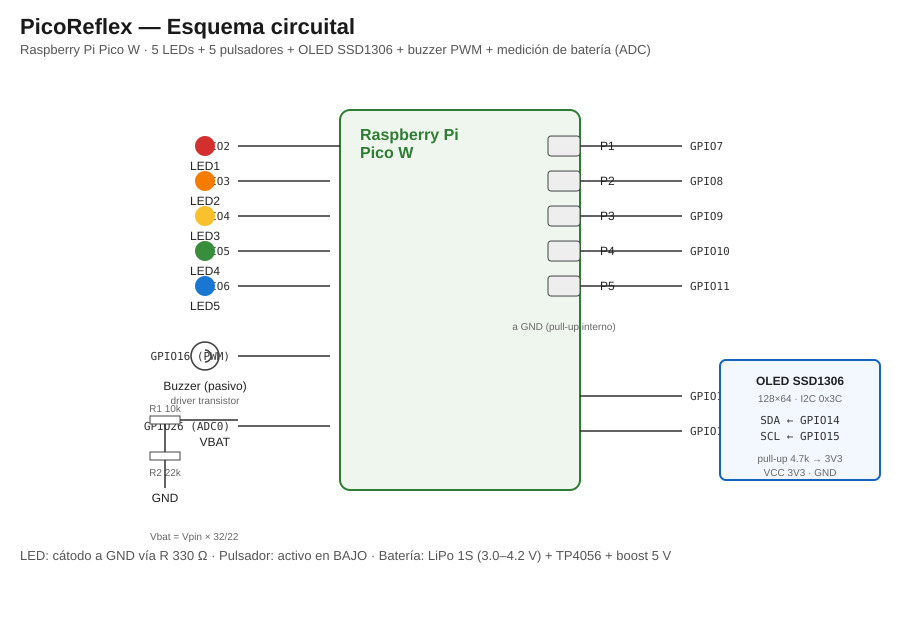

# Esquemático y Diagrama Circuital — PicoReflex

Este documento describe el **esquema circuital** del PicoReflex: la conexión de
cada periférico a la Raspberry Pi Pico W, los componentes y valores, y los
cálculos de dimensionamiento. Es el "Diagrama circuital" que pide la consigna
(`Idea.md`, punto 2 de la sección "Puntos a Cubrir en el Informe Final").

La fuente de verdad de los pines está en [`include/pin_defs.hpp`](https://github.com/AlessandroKlein/PicoReflex/blob/main/include/pin_defs.hpp).



---

## 1. Diagrama de bloques

```text
                        ┌────────────────────────────────────────────┐
                        │            Raspberry Pi Pico W             │
                        │                                            │
   LED 1 ──[R 330 Ω]─── │ GPIO2                              GPIO7   │──[P1]── GND
   LED 2 ──[R 330 Ω]─── │ GPIO3                              GPIO8   │──[P2]── GND
   LED 3 ──[R 330 Ω]─── │ GPIO4                              GPIO9   │──[P3]── GND
   LED 4 ──[R 330 Ω]─── │ GPIO5                             GPIO10   │──[P4]── GND
   LED 5 ──[R 330 Ω]─── │ GPIO6                             GPIO11   │──[P5]── GND
                        │                                            │
   OLED SDA ────────────│ GPIO14 (SDA, I2C1)                GPIO15   │──────── OLED SCL
                        │        └──[4.7 kΩ]── 3V3                    │
                        │                                            │
   Buzzer ──[R 1 kΩ]────│ GPIO16 (PWM)                               │
                        │                                            │
   VBAT ────[R1 10 kΩ]──┼─ GPIO26 (ADC0)                             │
                        │       └──[R2 22 kΩ]── GND                  │
                        │                                            │
                        └────────────────────────────────────────────┘
        (Todos los LEDs comparten GND; los pulsadores usan pull-up interno)
```

---

## 2. Tabla de conexiones (resumen)

| Periférico | Pin Pico W | Modo / Periférico | Componente externo |
| :--- | :--- | :--- | :--- |
| LED 1..5 | GPIO 2..6 | Salida digital (alto = encendido) | Resistor limitador 330 Ω en serie |
| Pulsador 1..5 | GPIO 7..11 | Entrada digital, pull-up interno (~50 kΩ), activo en BAJO | Pulsador a GND |
| Display OLED SSD1306 | SDA = GPIO14, SCL = GPIO15 | I2C1, 400 kHz, dirección 0x3C/0x3D | Pull-up 4.7 kΩ a 3V3 |
| Buzzer pasivo | GPIO16 | PWM (tonos) | Driver a transistor (ver §3.4) |
| Medición de batería | GPIO26 = ADC0 | ADC (0..3.3 V) | Divisor R1=10 kΩ / R2=22 kΩ |
| LED onboard (estado Wi-Fi) | Interno CYW43 | — | — (integrado en el módulo) |

> **Alternativa WS2812 (NeoPixel):** en lugar de los 5 LEDs GPIO, se puede usar una
> tira de LEDs direccionables **WS2812** en **GPIO28** (controlada por PIO). Se
> habilita con la macro `PICOREFLEX_WS2812 1` en `include/config.hpp`. Permite color
> por LED y efectos de luces al ganar/perder. Ver `docs/DECISIONES.md` §28.

---

## 3. Detalle por subsistema

### 3.1 LEDs indicadores (GPIO 2..6)

- Cada LED se enciende cuando el GPIO está en nivel **ALTO** (el cátodo va a GND a
  través de la resistencia limitadora).
- **Resistencia limitadora (330 Ω)** — cálculo con la ley de Ohm:

  ```
  R = (V_GPIO - Vf) / I
    = (3.3 V - 2.0 V) / 0.010 A   ≈ 130 Ω  (para 10 mA con Vf = 2.0 V)
  ```

  Se elige **330 Ω** (valor estándar) para limitar la corriente a ~4 mA: suficiente
  para ver el LED y con margen de seguridad para el GPIO (máx. recomendado ~12 mA).

### 3.2 Pulsadores (GPIO 7..11)

- **Pull-up interno** activado (`gpio_pull_up`). El pulsador conecta el pin a GND.
  - Botón **sin pulsar** → nivel ALTO (1).
  - Botón **pulsado** → nivel BAJO (0) → flanco de bajada → interrupción.
- No requiere resistencia externa (se usa el pull-up interno de ~50 kΩ). Si se desea
  más robustez, puede agregarse un pull-up externo de 10 kΩ.

### 3.3 Display OLED SSD1306 (I2C1, GPIO14/GPIO15)

- **SDA** = GPIO14, **SCL** = GPIO15 (periférico **I2C1**).
- Velocidad: **400 kHz** (fast mode).
- Dirección I2C: **0x3C** (o 0x3D en clones).
- Alimentación: 3V3 y GND.
- **Pull-ups de 4.7 kΩ** en SDA y SCL hacia 3V3 (obligatorios en I2C).

### 3.4 Buzzer pasivo (GPIO16, PWM)

- El buzzer **pasivo** necesita una señal alterna (PWM) para sonar; el GPIO no
  entrega corriente suficiente, por lo que se recomienda un **driver a transistor**:

  ```
  GPIO16 ──[R 1 kΩ]── Base (2N2222 / BC547)
                        Emisor ── GND
                        Colector ── Buzzer ── 5V (o 3V3)
  ```

- La frecuencia del PWM define el tono (ej. 440 Hz = La4, 880 Hz = La5).

### 3.5 Medición de batería (ADC0, GPIO26)

- Se usa un **divisor resistivo externo** para bajar la tensión de la batería al
  rango del ADC (0..3.3 V):

  ```
  VBAT (+) ──[R1 = 10 kΩ]──┬── GPIO26 (ADC0)
                            │
                           [R2 = 22 kΩ]
                            │
                          GND
  ```

- **Fórmula:** `Vpin = Vbat · R2 / (R1 + R2) = Vbat · 22 / 32 = Vbat · 0.6875`.
- **Reconstrucción:** `Vbat = Vpin · 32 / 22 ≈ Vpin · 1.4545`.
- Verificación de rango (LiPo 1S, 3.0–4.2 V):
  - `Vbat = 4.2 V` → `Vpin = 2.89 V` ✅ (< 3.3 V)
  - `Vbat = 3.0 V` → `Vpin = 2.06 V` ✅
- En el firmware: `Vbat(mV) = Vpin(mV) × 32 / 22` (ver `src/battery_monitor.cpp`).

### 3.6 Alimentación

- **Batería:** LiPo / Li-Ion **1 celda (1S)**, 3.0–4.2 V (nominal 3.7 V), 1200–2000 mAh.
- **Carga:** módulo **TP4056** (con protección) para cargar la batería.
- **Regulación:** conversor **Step-Up/Boost a 5 V** para alimentar VSYS de la Pico W
  (o la batería directa a VSYS, que admite 1.8–5.5 V).
- **Consumo estimado:** Pico W + Wi-Fi ~70–90 mA; LEDs + OLED + buzzer ~30–50 mA;
  total ~120–140 mA. Autonomía con 1800 mAh ≈ 12–15 h.

---

## 4. Mapa de pines completo

| GPIO | Función | Uso en PicoReflex |
| :--- | :--- | :--- |
| 2 | GPIO | LED 1 |
| 3 | GPIO | LED 2 |
| 4 | GPIO | LED 3 |
| 5 | GPIO | LED 4 |
| 6 | GPIO | LED 5 |
| 7 | GPIO | Pulsador 1 (pull-up) |
| 8 | GPIO | Pulsador 2 (pull-up) |
| 9 | GPIO | Pulsador 3 (pull-up) |
| 10 | GPIO | Pulsador 4 (pull-up) |
| 11 | GPIO | Pulsador 5 (pull-up) |
| 14 | I2C1 SDA | Display OLED (SDA) |
| 15 | I2C1 SCL | Display OLED (SCL) |
| 16 | PWM | Buzzer pasivo |
| 26 | ADC0 | Medición de batería (divisor 10 k/22 k) |
| — | CYW43 (LED onboard) | Indicador de estado Wi-Fi |
| 23/24/25/29 | SPI CYW43 | Wi-Fi (internos del módulo) |

> Nota: GPIO29 (ADC3/VSYS) está ocupado por el SPI del Wi-Fi y por el divisor
> interno VSYS/3 del módulo, por eso la batería se mide por **GPIO26 (ADC0)**.

---

## 5. Referencias

- Asignación de funciones de pines (GPIO function select):
  <https://www.raspberrypi.com/documentation/pico-sdk/hardware.html#hardware_gpio>
- ADC (GPIO26..29 → ADC0..ADC3):
  <https://www.raspberrypi.com/documentation/pico-sdk/hardware.html#hardware_adc>
- PWM:
  <https://www.raspberrypi.com/documentation/pico-sdk/hardware.html#hardware_pwm>
- I2C:
  <https://www.raspberrypi.com/documentation/pico-sdk/hardware.html#hardware_i2c>
- Datasheet de la Raspberry Pi Pico W:
  <https://datasheets.raspberrypi.com/picow/pico-w-datasheet.pdf>
