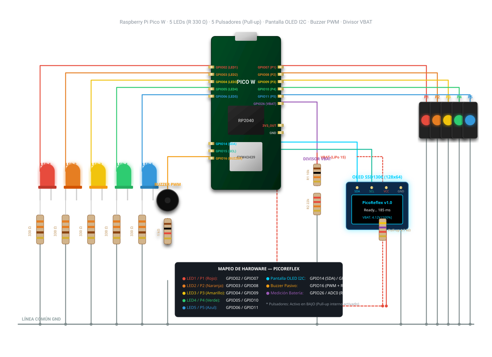
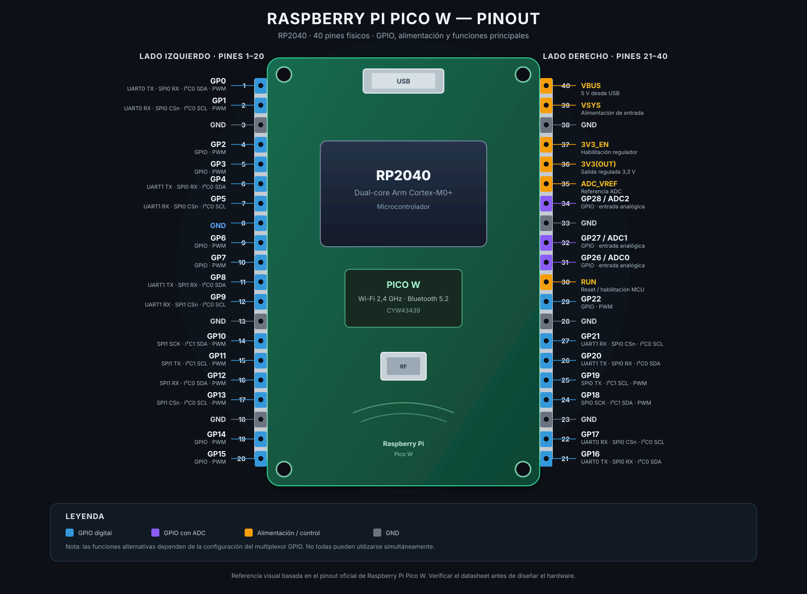

# Esquemático y Pinout — PicoReflex

Este documento reúne el **esquema de conexiones** y el **pinout de referencia**
del PicoReflex, el juego de reacción para **Raspberry Pi Pico W** (RP2040 +
radio inalámbrica CYW43439) programado en **C/C++ con la Pico SDK oficial 2.3.0**.

La fuente de verdad de los pines está en
[`include/pin_defs.hpp`](https://github.com/AlessandroKlein/PicoReflex/blob/main/include/pin_defs.hpp).
El resumen tabular de la conexión de cada periférico está en
[Arquitectura.md §7](Arquitectura.md).

## Esquema de conexiones

## Pinout de referencia

---

Ver también:

- [Arquitectura](Arquitectura.md) — bloques, tareas FreeRTOS y mapa de Flash.
- [Compilación y flasheo](Compilacion.md) — compilación para `PICO_BOARD=pico_w`.
- [Pinout oficial de la Raspberry Pi Pico W (A4, RP-008315-DS-1)](https://pip-assets.raspberrypi.com/categories/686-raspberry-pi-pico-w/documents/RP-008315-DS-1-PicoW-A4-Pinout.pdf)
